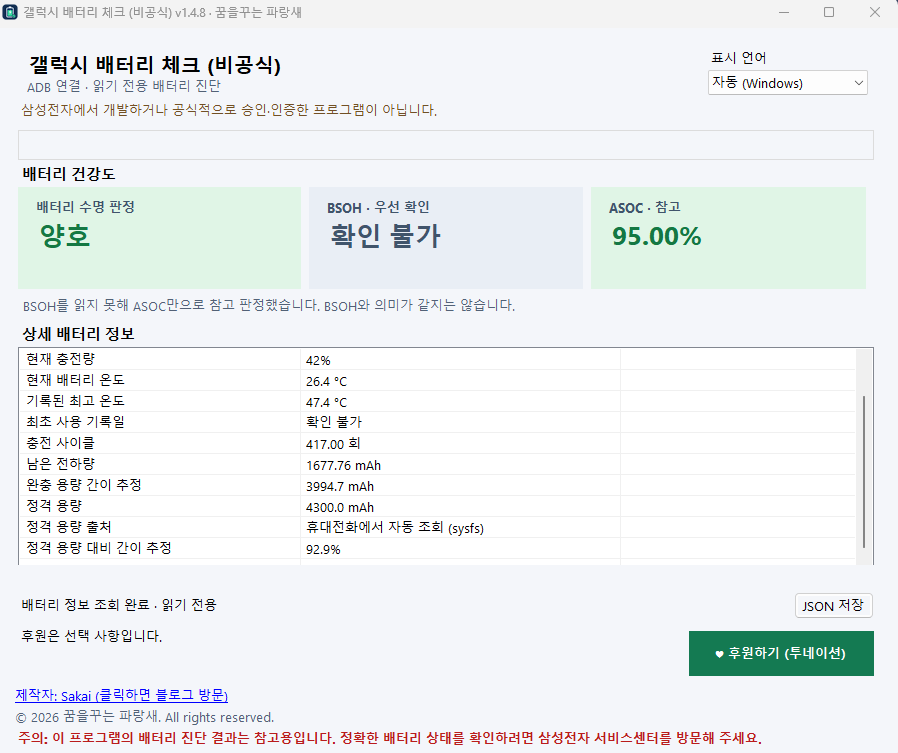

# Galaxy Battery Check — Samsung Galaxy Battery Health Checker

**v1.4.8 | Windows 10/11 | C# / .NET 8 | ADB | Unofficial**

[한국어](#한국어) · [English](#english) · [Binaries / Download](#binaries--download) · [Building](#building) · [License](#저작권-및-무단-수정재배포-금지) · [VirusTotal](#virustotal-검사-결과--파일-무결성)

Galaxy Battery Check is a Windows battery diagnostic information viewer for Samsung Galaxy smartphones. It uses Android Debug Bridge (ADB) to read available battery information without root access. The application is independent and not endorsed by Samsung Electronics.



## Features

- BSOH and ASOC displayed separately when the device provides them
- Battery temperature, charge level, cycle count, and available capacity information
- Automatic device discovery and selection of multiple connected devices
- Read-only diagnostics with an optional JSON report
- Windows Forms GUI and command-line interface
- Korean, English, and Japanese localization

## Binaries / Download

**Latest release: [Galaxy Battery Check v1.4.8](https://github.com/M26Pershing90mm/Galaxy-Smartphone-Battery-Check/releases/tag/v1.4.8)**

Use the **Assets** section of the release page to obtain the complete portable distribution ZIP when it is attached. The GitHub repository's **Code → Download ZIP** contains repository sources, not necessarily the compiled Windows program. Do not download or execute unverified copies from other distributors.

Extract the entire release archive, then launch `run-gui.cmd` or `win-x64/GalaxyBatteryCheck.exe`. Official [Android SDK Platform-Tools](https://developer.android.com/tools/releases/platform-tools) and USB debugging authorization are required.

## Building

Build requirements: Windows and the **.NET 8 SDK** (the Desktop Runtime alone is insufficient).

```powershell
.\build.cmd
# Include the .NET runtime in the Windows x64 portable build:
.\build.cmd -SelfContained
```

Additional build, CLI, and ADB instructions are provided in the Korean and English sections below.

## License and permitted use

**No open-source license is granted.** Unauthorized modification, redistribution, reuploading, mirroring, and commercial reuse are prohibited without the copyright holder's prior written permission, subject to applicable legal exceptions and GitHub's Terms of Service.

See [LICENSE](LICENSE) and [저작권 및 무단 수정·재배포 금지](#저작권-및-무단-수정재배포-금지).

---

> **비공식 프로그램 고지:** 삼성전자가 제작하거나 공식 승인·인증·후원한 프로그램이 아닙니다. 배터리 진단 결과는 참고용이며 삼성전자 서비스센터의 정밀 검사와 동일하지 않습니다. 삼성 및 Galaxy는 해당 권리자의 상표입니다.

## 한국어

### 프로그램 소개

Galaxy Battery Check는 Windows PC에서 ADB(Android Debug Bridge)로 연결된 Samsung Galaxy 기기의 **배터리 정보를 읽기 전용으로 조회**하는 프로그램입니다. 루팅 없이 동작하며, 기기에서 제공하지 않는 지표를 임의 생성하지 않습니다. 데스크톱 GUI와 명령줄(CLI)을 지원하고 **한국어·영어·일본어**로 표시할 수 있습니다. 자동 언어 감지는 Windows UI 언어를 기준으로 합니다.

**버전 전환:** 기존 GitHub의 v1.4.4는 Python/Tkinter 코드였습니다. v1.4.8의 주 구현은 **C# / .NET 8 Windows Forms**로 변경되었습니다. `galaxy battery check.py`, `galaxy battery gui.py`, `galaxy battery check.pyw`는 **구버전 Python용 파일**이며 1.4.8 실행에 사용하지 않습니다. 기존 파일을 보관해야 한다면 `legacy/python-v1.4.4/`에 옮기거나 Git 이력으로 복구하세요. 이전 Python 명령으로 새 C# 버전을 실행할 수 없습니다.

### 주요 기능

- ADB 연결 기기를 약 4초 간격으로 감지하고 새 연결 기기 배터리 정보 자동 조회. 수동 재조회 및 다중 기기 선택 가능
- BSOH와 ASOC를 구분해 표시. **BSOH 우선** 배터리 수명 참고 판정, BSOH가 없으면 **ASOC 참고 판정**으로 명시
- 비공식 색상 구간: **90% 이상 양호**, **80% 이상 90% 미만 주의**, **80% 미만 점검 권장**. 측정값이 없으면 판정 불가
- BSOH와 ASOC 차이가 10%p 이상일 경우 경고
- 배터리 잔량, 온도, 기록된 최고 온도, 충전 사이클, 전하량 등 기기에서 읽을 수 있는 항목 표시
- 기기에서 `charge_full_design` 정격 용량을 제공하면 표시; 미제공 시 확인 불가. 정격 용량 수동 입력 및 간이 용량 추정 제공
- JSON 저장, 포터블 실행 및 바탕화면 바로가기 생성, CLI 활용

**해석 주의:** 배터리 잔량(%)은 배터리 수명(%)이 아닙니다. **BSOH와 ASOC는 동일한 지표가 아닙니다.** `완충 용량 간이 추정`은 전하량과 잔량 등을 이용한 단순 계산이며 정밀 실측 용량이 아닙니다. 색상 판정 구간도 삼성의 공식 교체 기준이 아닙니다. 모델·펌웨어·One UI 버전·읽기 권한에 따라 노출되는 값이 달라집니다.

### 다운로드와 실행 — Windows 10/11 x64

**공식 배포:** GitHub [Releases](https://github.com/M26Pershing90mm/Galaxy-Smartphone-Battery-Check/releases) 페이지에서 배포 ZIP 및 릴리스 노트를 확인하세요. `Code → Download ZIP`은 소스 코드이므로 실행 가능한 EXE가 포함되지 않을 수 있습니다.


**실행 패키지와 소스 코드는 다릅니다.** 이 문서의 검사 대상인 `GalaxyBatteryCheck-v1.4.8.zip`에는 소스와 `win-x64` 실행 파일이 모두 포함되어 있습니다. 다만 GitHub 저장소를 소스 중심으로 게시한 경우 `Code → Download ZIP`에는 EXE가 없을 수 있으므로, 실행 파일이 필요한 사용자는 Releases 배포본의 구성을 확인하거나 아래 방법으로 직접 빌드하세요. 출처가 확인되지 않은 EXE는 실행하지 마세요.

1. 포터블 배포본을 압축 해제합니다. `GalaxyBatteryCheck.exe` 파일 하나만 분리하면 필요한 DLL·JSON·런타임 파일을 찾지 못할 수 있습니다.
2. 배포본 최상위 폴더에서 **`run-gui.cmd`**를 더블클릭하거나 `win-x64\GalaxyBatteryCheck.exe`를 직접 실행합니다.
3. ADB를 설치하고 휴대전화 USB 디버깅을 허용합니다(아래 참고).
4. 기기 연결 후 자동 조회하거나 화면의 **배터리 조회**를 누릅니다. 여러 기기면 대상 기기를 선택합니다.
5. 필요하면 **JSON 저장** 버튼으로 결과를 보관합니다. JSON에는 기기 식별 정보가 들어갈 수 있으므로 외부 공유 전에 반드시 확인하세요.

첨부 v1.4.8 포터블 배포본의 설명에 따르면 런타임 포함(self-contained) 빌드는 별도 .NET 설치가 필요 없습니다. 일반적인 **런타임 비포함(framework-dependent) 빌드**는 Windows x64용 **.NET 8 Desktop Runtime**을 설치해야 합니다. 배포본 종류를 확인하세요.

### ADB 설치와 휴대전화 연결

- [Google 공식 Android SDK Platform-Tools](https://developer.android.com/tools/releases/platform-tools)에서 Windows ZIP 다운로드 → 압축 해제. `adb.exe` **단독 복사 금지**: 함께 제공되는 DLL이 필요합니다.
- 배포 폴더 내 자동 탐지를 이용한다면 `win-x64/platform-tools/adb.exe` 구조로 폴더 전체를 넣습니다. 별도 위치라면 프로그램에서 `adb.exe` 경로를 지정합니다.
- 갤럭시 **설정 → 휴대전화 정보 → 소프트웨어 정보 → 빌드번호 7회 터치** → 개발자 옵션에서 USB 디버깅 켜기 → USB 데이터 케이블 연결 → 휴대전화의 디버깅 허용 승인.
- Windows에서 기기를 인식하지 못한다면 [Samsung Android USB Driver](https://developer.samsung.com/android-usb-driver)를 확인하세요.
- 연결 확인 (PowerShell):

```powershell
& "C:\platform-tools\adb.exe" devices
```

`device`는 승인 완료, `unauthorized`는 휴대전화에서 디버깅 승인 필요, `offline`은 연결 재확인이 필요함을 뜻합니다. ADB 연결이 되더라도 기기/펌웨어가 일부 배터리 필드를 제공하지 않을 수 있습니다.

### 소스에서 빌드하기

**요구 사항:** Windows, .NET 8 SDK (Desktop Runtime만으로는 빌드 불가), 대상 플랫폼용 AppHost/참조 팩. 프로젝트는 별도 외부 NuGet 라이브러리 의존성이 없지만 오프라인 빌드는 필요한 SDK·런타임 팩이 **이미 설치/캐시**되어야 합니다.

```powershell
dotnet --list-sdks
.\build.cmd
# 런타임까지 포함하는 Windows x64 포터블 빌드
.\build.cmd -SelfContained
# 별도 ARM64 결과물 (해당 대상 팩 필요)
.\build.cmd -Runtime win-arm64 -SelfContained
```

빌드 스크립트는 솔루션 빌드 → Core 테스트 → GUI/CLI publish를 실행하며 결과는 `win-x64/`(또는 선택한 플랫폼 폴더)에 생성됩니다. 누락된 SDK/팩을 자동으로 다운로드하지 않도록 설정되어 있으므로 오프라인 환경에서 의존성이 부족하면 빌드가 실패할 수 있습니다. ARM64/x86은 실제 환경 테스트가 별도 필요합니다.

GUI 실행: `run-gui.cmd` · CLI 도움말: `run-cli.cmd --help` · 바로가기: `CreateShortcut.cmd`. 바로가기는 설치 프로그램이 아니며, 현재 프로그램 폴더 위치를 가리키므로 폴더 이동 뒤에는 다시 만드세요.

### CLI 사용

```bat
run-cli.cmd --language ko --help
run-cli.cmd --language ko --adb "C:\platform-tools\adb.exe" --json
run-cli.cmd --language ja --adb "C:\platform-tools\adb.exe" --rated-mah 5000 --redact-serial --save report.json
run-cli.cmd --version
```

| 옵션 | 용도 |
| --- | --- |
| `--language ko\|en\|ja` | 출력 및 오류 언어 |
| `--adb PATH` | 공식 ADB 실행 파일 경로 |
| `--serial SERIAL` | 여러 연결 기기 중 대상 선택 |
| `--rated-mah N` | 정격 용량 지정 (100~30000mAh) |
| `--no-sysfs` | 추가 sysfs 조회 건너뛰기 |
| `--json` | JSON으로 결과 출력 |
| `--save FILE` | JSON 저장 |
| `--redact-serial` | 시리얼 뒷자리 외 마스킹 |
| `--version` | 버전 출력 |

CLI 공유 시 `--redact-serial`을 권장합니다. GUI JSON에는 기기 시리얼번호가 포함될 수 있습니다. 저장 전에 개인정보 포함 여부를 확인하세요.

### VirusTotal 검사 결과 / 파일 무결성

아래 결과는 **2026-11-15에 첨부 원본의 바이트를 직접 SHA-256으로 계산하여** VirusTotal URL의 해시와 일치함을 확인한 것입니다. 탐지 엔진 수나 무해 여부를 검증한 것은 아닙니다.

| 대상 파일 | SHA-256 | VirusTotal 검사 링크 |
| --- | --- | --- |
| 전체 배포 압축 파일 `GalaxyBatteryCheck-v1.4.8.zip` | `5ed4ecc8c519bc06f378a004ad5e1acc4e31433524a7167d559ed1d64fe67263` | [ZIP 보고서](https://www.virustotal.com/gui/file/5ed4ecc8c519bc06f378a004ad5e1acc4e31433524a7167d559ed1d64fe67263?nocache=1) |
| Windows GUI `win-x64/GalaxyBatteryCheck.exe` | `b2e996cf093cdc826b8fe8768ce2e96dfd8c7ec4b8d3d0b7025b7f2f9a79695d` | [EXE 보고서](https://www.virustotal.com/gui/file/b2e996cf093cdc826b8fe8768ce2e96dfd8c7ec4b8d3d0b7025b7f2f9a79695d) |

**중요:** 다른 이름으로 재압축하거나, 소스 코드를 변경해 다시 빌드하면 SHA-256이 달라질 수 있습니다. 그 경우 위 VirusTotal 결과는 해당 새 파일에 적용되지 않습니다. VirusTotal 탐지 결과는 최종 안전성 보증이 아닙니다. 탐지 숫자는 웹 보고서에서 직접 확인하세요.

파일 해시 확인 (PowerShell):

```powershell
Get-FileHash -Algorithm SHA256 ".\GalaxyBatteryCheck-v1.4.8.zip"
Get-FileHash -Algorithm SHA256 ".\win-x64\GalaxyBatteryCheck.exe"
```

### 저작권 및 무단 수정·재배포 금지

**별도의 오픈소스 라이선스를 부여하지 않습니다(No License Granted).** Galaxy Battery Check 및 본 프로젝트에서 저작권자가 소유한 소스 코드·실행 파일·문서·이미지는 저작권자의 사전 서면 허가 없이 수정·재배포할 수 없습니다.

- **무단 수정 금지:** 저작권자의 사전 서면 허락 없이 소스 코드 또는 실행 파일을 수정·개작하거나, 수정본을 공개·배포하는 것을 허용하지 않습니다.
- **무단 배포 금지:** 원본 또는 수정본의 실행 파일, 소스 코드 및 배포 ZIP을 허락 없이 재배포·미러링·재업로드하거나 제삼자에게 배포하는 것을 허용하지 않습니다.
- **무단 상업적 이용 금지:** 프로그램 또는 그 일부를 무단으로 판매·유료 서비스에 포함·상업적 재사용하는 권한을 부여하지 않습니다.
- 사용 허가, 수정·배포 권한이 필요한 경우 **사전에 저작권자에게 서면 허락**을 받아야 합니다. 본 저장소의 공개 자체는 오픈소스 라이선스나 재배포 허가를 의미하지 않습니다.
- 위 제한은 **관련 법률상 강행 규정·예외, GitHub 서비스 약관상 허용되는 행위** 및 별도의 정당한 권한까지 배제하지 않습니다. 제삼자 구성요소(예: ADB)에는 각 권리자의 라이선스가 적용됩니다.

자세한 내용: [`LICENSE`](LICENSE) (라이선스 허가서가 아니라 **저작권·권리 유보 고지**입니다).

### 보안, 개인정보 및 오프라인 동작

- 이 프로그램은 읽기 전용 배터리 조회용이며 루팅이나 배터리 설정 수정이 필요하지 않습니다.
- 진단 결과는 PC에서 처리됩니다. **진단 기능**에는 인터넷이 필요하지 않으며 블로그 및 후원 링크는 사용자가 클릭할 경우 외부 브라우저로 열립니다.
- ADB는 사용자가 별도로 설치하는 Google Platform-Tools 실행 파일입니다. 프로그램은 전용 로컬 ADB 세션을 사용하고 종료 시 관련 프로세스를 정리하도록 구현되어 있습니다. 다른 앱의 ADB 서버에 `kill-server`하지 않는 설계입니다.
- ADB USB 디버깅을 사용한 뒤에는 필요하지 않으면 휴대전화의 USB 디버깅을 끄세요.
- 이 도구는 삼성이 승인한 진단/수리 판정용 소프트웨어가 아닙니다. 정확한 배터리 상태 및 교체 판단은 삼성 공식 서비스센터를 이용하세요.

### 테스트와 한계

```powershell
dotnet run --project GalaxyBatteryCheck.Core.Tests -c Release --no-restore
# 실제 ADB 세션/프로세스 검사에는 별도 adb.exe 및 Windows 환경 필요
dotnet run --project GalaxyBatteryCheck.Core.Tests -c Release --no-restore -- --adb "C:\platform-tools\adb.exe"
```

소스 패키지에는 `VALIDATION.md`, `VALIDATION-1.4.8.md`, `검사-빌드-검증보고서.md`가 포함됩니다. 과거 보고서의 주장과 현재 머신에서 직접 재검증한 결과는 구분해야 합니다. **실제 스마트폰 연결, 모든 모델 호환성, 사용자 Windows에서의 GUI 실행은 각 환경에서 별도 확인이 필요합니다.**

### 저장소 업그레이드 / GitHub 교체

기존 GitHub 저장소의 Python v1.4.4를 별도 브랜치 또는 `legacy/python-v1.4.4/`에 보존한 뒤 이 소스 묶음의 **내용물**을 저장소 루트로 복사하세요. 현재 README는 v1.4.8 기준이므로 교체합니다. 기존 `NOTICE.txt` 등 저작권·법적 고지와 이미지·라이선스·기타 유효한 프로젝트 자산이 있으면 유지하세요. 소스 배포에 `win-x64` 런타임 파일 전체를 커밋할 필요는 없으며 완전한 포터블 빌드는 별도 GitHub Releases에 배포하는 편이 적절합니다. 구버전 Python 실행 파일을 루트에 그대로 둘 경우 신규 사용자가 혼동할 수 있으므로 별도 `legacy/`로 이동하는 것을 권장합니다.

---

## English

Galaxy Battery Check v1.4.8 is an **unofficial, read-only Windows battery information viewer for Samsung Galaxy devices** using Android Debug Bridge (ADB). It is not affiliated with, sponsored, certified, or endorsed by Samsung Electronics. **BSOH and ASOC are distinct indicators** and may not be available on every device or firmware. Color thresholds and calculated capacity estimates are informational only, not Samsung's official diagnostics.

**What's new:** the main implementation has moved from Python/Tkinter (legacy v1.4.4) to **C# / .NET 8 Windows Forms**. The application provides Korean/English/Japanese UI and CLI, automatic connected-device detection, BSOH-first assessment with ASOC explicitly marked as a fallback reference, battery-cycle/temperature readings when available, JSON export, and portable Windows distribution.

**Running the app:** Download and fully extract a Windows x64 portable release containing the compiled executables. Run `run-gui.cmd` or `win-x64/GalaxyBatteryCheck.exe`. A GitHub **source-only** ZIP may not include executables, while the uploaded `GalaxyBatteryCheck-v1.4.8.zip` examined here contains a `win-x64` executable. Self-contained releases include their .NET runtime; framework-dependent builds need the matching **.NET 8 Desktop Runtime**. Do not separate the EXE from its accompanying dependencies.

**ADB setup:** Download Google's official [SDK Platform-Tools](https://developer.android.com/tools/releases/platform-tools). Keep its DLLs with `adb.exe`; put the entire `platform-tools` folder under `win-x64/` or choose the executable in the GUI. Enable Developer options and USB debugging on the phone; connect a data-capable USB cable and approve the authorization prompt. Check the connection with `adb devices`. Use an official [Samsung USB driver](https://developer.samsung.com/android-usb-driver) if needed.

**Build from source:** Requires Windows and the **.NET 8 SDK**, plus local target build/runtime packs for offline publish. Run `build.cmd` for a framework-dependent x64 build, or `build.cmd -SelfContained` for a runtime-inclusive build. Tests run as part of `build.cmd`. Other architectures have not been verified on real machines in this environment.

**CLI:** `run-cli.cmd --language en --adb "C:\platform-tools\adb.exe" --json --redact-serial --save report.json`. Use `--help` for options. GUI JSON exports may contain the device serial; review exported data before sharing. The program does not download or install ADB or .NET and does not need the Internet for local battery querying. Donation/blog buttons open external pages only when clicked.

### Copyright and restrictions on unauthorized modification or redistribution

**No open-source license is granted.** The source code, binaries, documentation, and original artwork owned by the copyright holder remain proprietary.

- **Unauthorized modification prohibited:** No permission is granted to modify or adapt the source code or executable, or to publish or distribute modified copies, without prior written authorization from the copyright holder.
- **Unauthorized redistribution prohibited:** No permission is granted to mirror, reupload, republish, or redistribute the original or modified application, source files, or release archives without prior written authorization.
- **Unauthorized commercial use prohibited:** No right is granted to sell, commercially reuse, or bundle the software within a commercial service without prior written authorization.
- Public access to this repository **does not constitute an open-source license** or a blanket redistribution grant. These statements are subject to mandatory legal exceptions, permissions provided by GitHub's Terms of Service, and any separately granted rights. Third-party components retain their own licenses.

Read [`LICENSE`](LICENSE), which is a **copyright notice and reservation of rights**, not an open-source license grant.

### VirusTotal file reports and SHA-256 verification

The two submitted VirusTotal links correspond to **different files**, and each SHA-256 was verified against the supplied v1.4.8 archive:

| Artifact | Verified SHA-256 | Report |
| --- | --- | --- |
| `GalaxyBatteryCheck-v1.4.8.zip` (entire uploaded distribution archive) | `5ed4ecc8c519bc06f378a004ad5e1acc4e31433524a7167d559ed1d64fe67263` | [VirusTotal ZIP report](https://www.virustotal.com/gui/file/5ed4ecc8c519bc06f378a004ad5e1acc4e31433524a7167d559ed1d64fe67263?nocache=1) |
| `win-x64/GalaxyBatteryCheck.exe` (Windows GUI executable inside the archive) | `b2e996cf093cdc826b8fe8768ce2e96dfd8c7ec4b8d3d0b7025b7f2f9a79695d` | [VirusTotal EXE report](https://www.virustotal.com/gui/file/b2e996cf093cdc826b8fe8768ce2e96dfd8c7ec4b8d3d0b7025b7f2f9a79695d) |

**Scope:** The hash comparison is verified; antivirus detection counts and malware-free status have **not** been independently verified. Repackaging or rebuilding changes the file hash, so these reports must not be attributed to different artifacts. You can verify the hash locally using `Get-FileHash -Algorithm SHA256` in PowerShell.

**Limitations:** Data availability depends on device, Android / One UI version, firmware, and access permissions. Unsupported values show as unavailable. State-of-health indicators, charge percentage, and estimated full capacity must not be confused with one another. For reliable battery servicing decisions use an authorized Samsung service provider.

---

Developed by **Sakai**  
Blog: https://wezard4u.tistory.com/ · Optional donations: [Toonation](https://toon.at/donate/637833976686140024) / [Ko-fi](https://ko-fi.com/sakai38666)  
Copyright and restrictions: [LICENSE](LICENSE). Release distribution: [Releases](https://github.com/M26Pershing90mm/Galaxy-Smartphone-Battery-Check/releases).